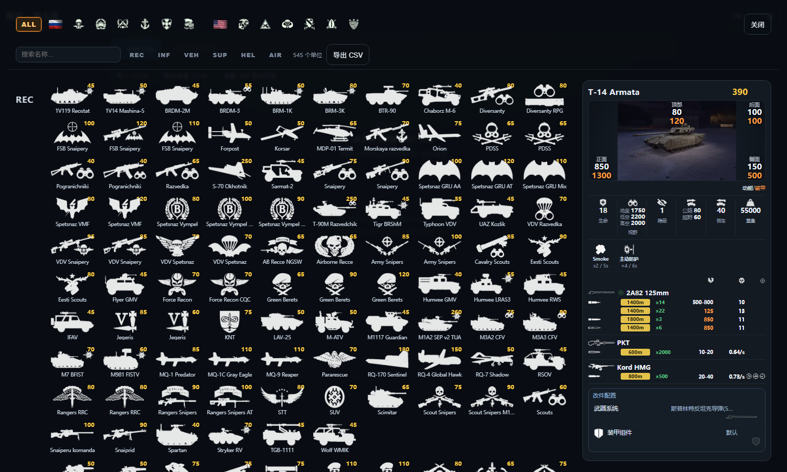
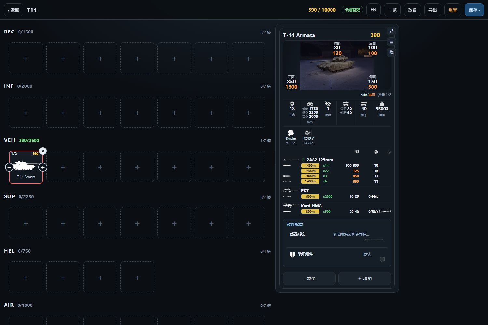
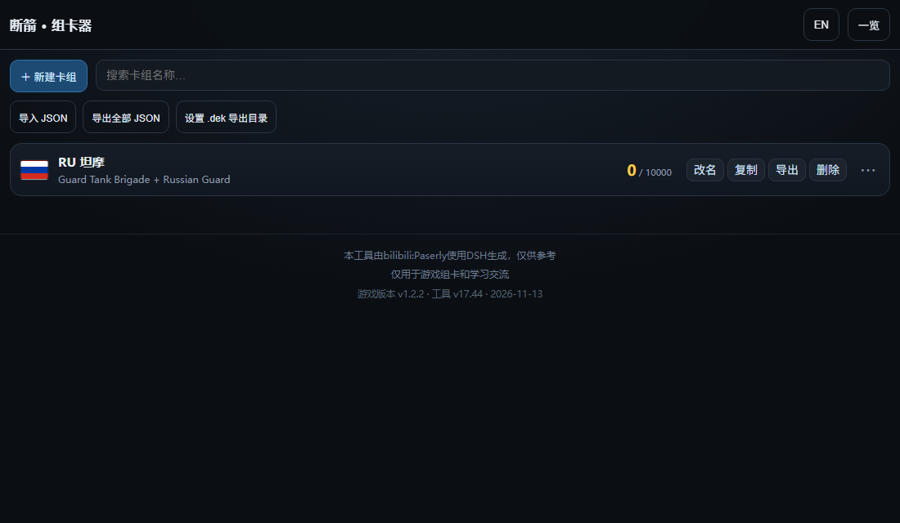
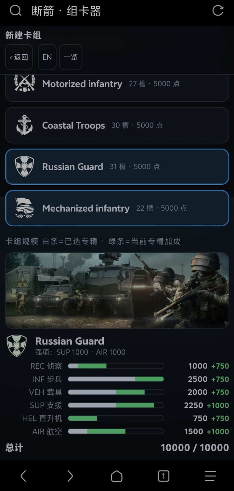
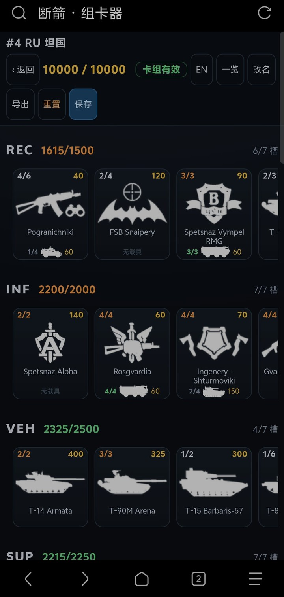
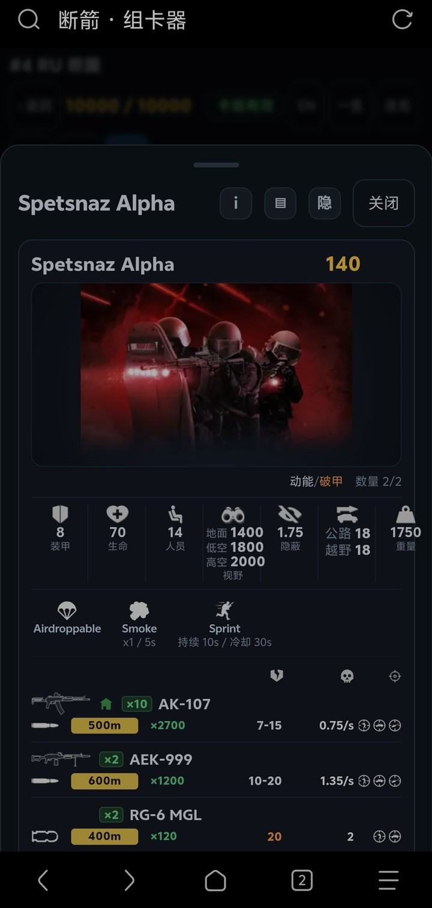

# 断箭 · 组卡器 / Broken Arrow · Deck Builder

《断箭》离线单文件组卡工具。双击 HTML 即用，不联网、不安装。界面支持**一键中英切换**（右上角 EN / 中文）。

An offline, single-file deck builder for *Broken Arrow*. Open the HTML and it works — no server, no install. The UI has a **one-click 中文 / EN switch** (top-right).

- 游戏版本 / Game: **v1.2.2**
- 工具版本 / Tool: **v17.44**（r2 修订 / r2 revision）
- 更新 / Updated: 2026-11-14（目标图标修复 / target-icon fix）

> 本工具由 bilibili:Paserly 使用 DSH 生成，仅供参考
> 仅用于游戏组卡和学习交流
>
> Made with DSH by bilibili:Paserly — for reference only
> For game deck-building and study purposes only

---

## 功能 / Features

| 中文 | English |
|---|---|
| 选国家 + 2 个专精，六大类槽位，实时点数 | Pick a country + 2 specializations, six slot categories, live points |
| 预算规则：单兵种超 10% 内橙色（有效）、超 10% 红色 ⚠ 无效、总分 >10000 无效 | Budget rules: up to 10% over a category cap is orange (valid); beyond that red ⚠ invalid; total over 10000 invalid |
| 军械库按游戏版式：国家/专精筛选、搜索、六个兵种、图标卡 + 右侧详情 | Arsenal in the in-game layout: nation/spec filters, search, six categories, icon cards + detail panel |
| 兵牌面板：装甲/生命/人员/视野/隐蔽/公路/越野/倒车/重量、特性、武器、改件 | Unit panel: armor, HP, crew, optics, stealth, road, off-road, reverse, weight, traits, weapons, customization |
| 武器行：件数、弹药、射程、穿深（化学能橙 / 动能白）、每秒伤害、瞄准装填 | Weapon rows: count, ammo, range, penetration (chemical orange / kinetic white), DPS, aim & reload |
| 编制载具：独立卡片、数量可调、默认展开 | Transports: separate card, adjustable count, expanded by default |
| 隐藏数值：原始值、来源字段、换算过程 | Raw values: original value, source field, conversion |
| 卡组管理：搜索、改名、复制、导出 .dek / JSON、删除、导入 | Deck management: search, rename, duplicate, export .dek / JSON, delete, import |
| 中英一键切换、手机适配 | One-click language switch, mobile layout |

## 使用 / Usage

**在线版 / Live demo**：<https://kwhaku.github.io/BA-Deck-Builder/> — 打开即用，不用下载
Open in your browser, nothing to download.

**下载 / Download**：[断箭组卡器_BA_v1.2.2.html](https://github.com/Kwhaku/BA-Deck-Builder/raw/main/断箭组卡器_BA_v1.2.2.html)（约 30 MB / ~30 MB）

1. 下载 `断箭组卡器_BA_v1.2.2.html` / Download `断箭组卡器_BA_v1.2.2.html`
2. 双击用浏览器打开（Chrome / Edge / 手机浏览器）/ Open it in any browser（也可直接访问上面的在线版）
3. 卡组存在浏览器本地；「导出 JSON」做备份，「导出 .dek」进游戏
   Decks stay in your browser; use Export JSON to back up, Export .dek to load into the game

### .dek 导出目录 / Export folder

第一次导出选一次游戏目录即可（之后不再弹框）：

```
C:\Users\<用户名>\AppData\LocalLow\SteelBalalaikaStudio\BrokenArrow\Decks
```

Pick the game's folder once on the first export; later exports write straight there.
On Android the tool opens the system share sheet — choose "Save to Files".

## 截图 / Screenshots

**桌面 / Desktop**





**安卓 / Android** — 手机浏览器直接开在线版，不用装 App
Opening the live version in a phone browser — no app to install

<p>
  
  
  
</p>

## 数据来源 / Data sources

全部数值来自**本机解包 + 运行态抓包 + 游戏内截图核对**，未引用第三方计算器结论。
All values come from **local unpacking + runtime capture + in-game screenshots**; no third-party calculators were used.

已核实 / Verified:

- **1 数据单位 = 2 米 / 1 data unit = 2 meters**（视野、射程、散布、爆炸半径）
- 造价 = 单位底价 + 各改件组默认项 / Cost = base cost + default option price of each group
- 弹药 = `Quantity × HUDMultiplier × 件数` / Ammo = `Quantity × HUDMultiplier × count`
- 每秒伤害 = 单发伤害 ÷ 爆发间隔 / DPS = damage per shot ÷ burst interval
- 化学能（`ArmorTargeted=2`）穿深为橙色单值，动能为白色区间 / Chemical shows a single orange penetration value, kinetic shows a white range

## 已知限制 / Known limitations

- **转弯半径 / Turn radius**：23 个飞行预设只有 3 个有实测值，其余留空（数据源无该字段，也没有可推导的公式）
- 少量未在游戏里逐个截图核对过的单位，件数/弹药按规则推导 / A handful of units were never checked against in-game screenshots
- 游戏显示的 Rate of fire 与工具口径不同，工具显示的是每秒伤害 / The in-game rate of fire uses a different definition, so the tool shows DPS

## 声明 / Disclaimer

- 非官方，与 Steel Balalaika / Slitherine 无关 / Unofficial, not affiliated with Steel Balalaika or Slitherine
- **仅用于游戏组卡和学习交流**，请勿商用 / **For game deck-building and study purposes only**, no commercial use
- 单位名称、图标、立绘等素材版权归游戏开发商所有 / Unit names, icons and artwork belong to the game's developers
- 使用本工具产生的任何问题由使用者自行承担 / Any issue caused by using this tool is the user's own responsibility

## 版本 / Versions

| 工具 / Tool | 日期 / Date | 内容 / Notes |
|---|---|---|
| v17.44-r2 | 2026-11-14 | 目标图标修复：武器行统一 6 列网格，目标类型 tts 按解包表重新对齐。程序内页脚仍显示 v17.44 / weapon row forced to a 6-column grid; TargetType bitmap realigned (in-app footer still reads v17.44) |
| v17.44 | 2026-11-13 | 军械库按游戏版式重做；中英一键切换；编辑页导出；改件与编制载具交互修复 |
| v17.43 | 2026-11-13 | 单文件中英切换 / single-file language switch |
| v17.42 | 2026-11-13 | 编辑页导出按钮、安卓导出文件名修复 |
| v1.2.2 | 2026-11-13 | 预算规则、安卓适配、页脚声明 |
